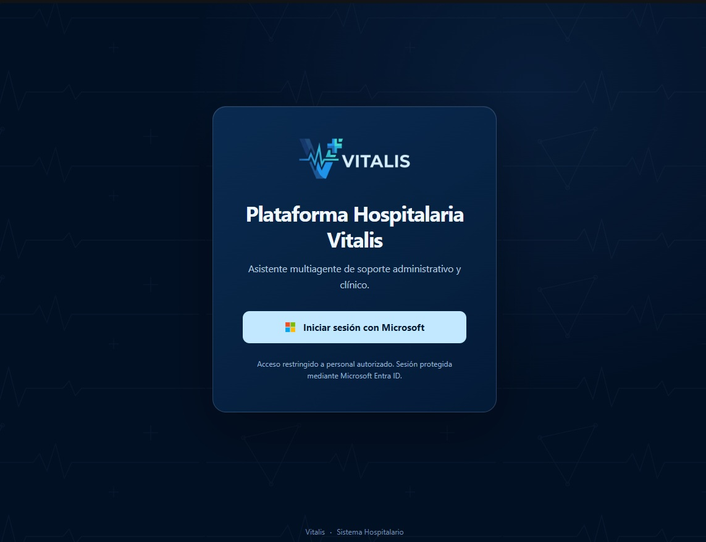
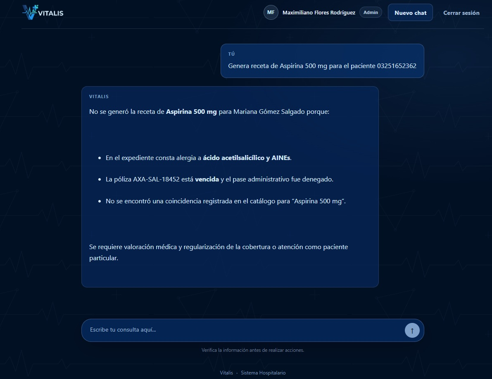
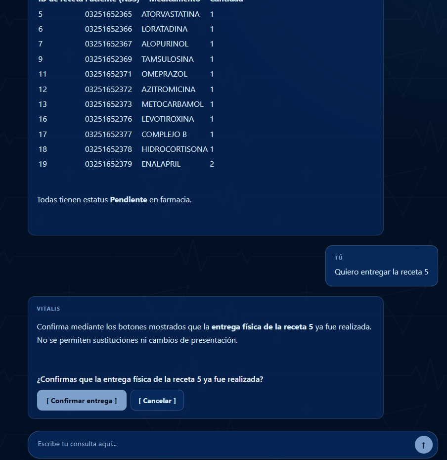
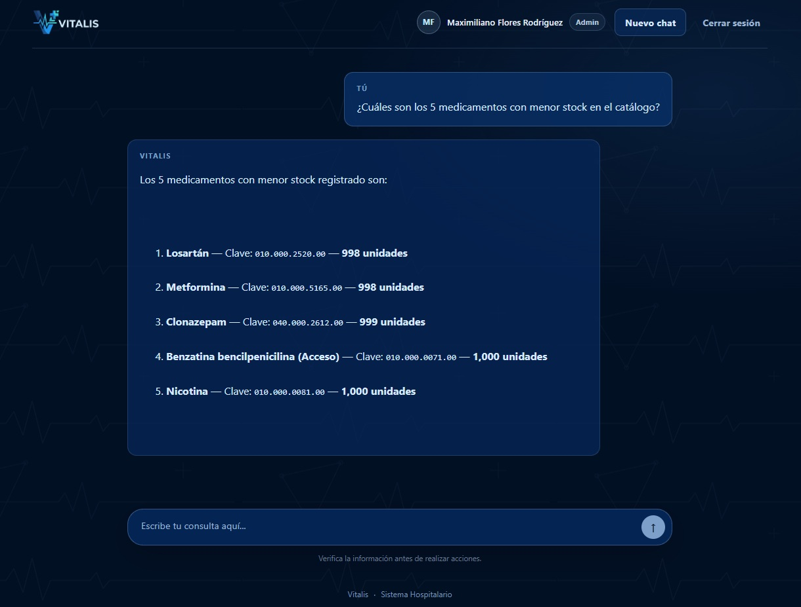
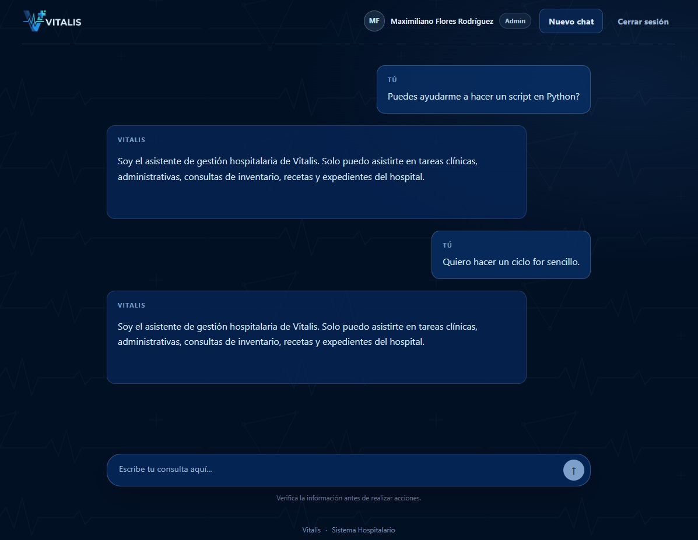

# Guía del Evaluador — Vitalis

**Guía ejecutiva y manual de navegación para la evaluación del sistema en vivo**

---

## 1. Bienvenida y ficha técnica del proyecto

Esta guía le acompaña paso a paso en la evaluación de Vitalis. Está pensada para recorrer los procesos de negocio,
sin necesidad de conocimientos de programación.

| Campo | Detalle |
| --- | --- |
| **Proyecto** | Vitalis — Sistema Integral de Gestión Hospitalaria (Fase 2 / MVP Empresarial en Producción) |
| **Alumno / Desarrollador** | Maximiliano Flores Rodríguez |
| **Entorno de evaluación** | [https://vitalis-app.azurewebsites.net](https://vitalis-app.azurewebsites.net) |
| **Acceso** | Inicio de sesión institucional con cuenta de Microsoft (Entra ID). El menú y las acciones disponibles dependen del rol del empleado. |

**Propósito.** Mostrar la evolución de los procesos hospitalarios manuales y en papel (**Fase 1**) hacia un
**asistente hospitalario centralizado en la nube** (**Fase 2**) que asiste de forma transversal a todas las áreas
clínicas, administrativas y logísticas: admisión, históricos, seguros, atención médica, farmacia e inventario.

**Cómo se usa, en una frase:** el empleado inicia sesión, escribe en lenguaje natural lo que necesita ("busca al
paciente…", "¿qué recetas están pendientes?") y Vitalis ejecuta la gestión que su rol permite.

> **Antes de empezar:** para recorrer las pruebas con distintos perfiles, la cuenta con la que inicie sesión debe
> estar registrada como empleado con el rol correspondiente. Las pruebas de la sección 4 requieren un perfil con
> acceso a todas las áreas (**Admin**), o bien el perfil indicado en cada fila.

---

## 2. Supuestos operativos del Modelo Mínimo Viable (MVP)

Para delimitar el alcance de esta fase se asumen seis premisas:

1. **Migración histórica completada.** Los expedientes en papel trabajados en la Fase 1 se consideran migrados en
   su totalidad a la base digital (`dbo.historicos`).
2. **Alcance acotado de Seguros.** El módulo se limita a la **validación binaria de vigencia de pólizas**
   (`Activa` frente a `Vencida` / `Suspendida`) para autorizar consultas. No incluye trámites complejos de
   coaseguros ni deducibles.
3. **Identidad preasignada.** Todo paciente que acude al hospital ya cuenta con un **Número de Seguridad Social
   (NSS)** asignado.
4. **Gobernanza y personal preconfigurado.** La plantilla reside en `dbo.empleados`, con correos institucionales
   `@vitalis.com` y roles asignados: `Admin`, `Medico`, `Farmacia`, `Admision`, `Historicos`, `Seguros` y
   `Finanzas`.
5. **Homologación de Triage y Consulta.** El registro de constantes vitales (triage) se integró directamente al
   módulo de Atención Médica (`dbo.atencion`), para evitar fragmentar roles sin necesidad.
6. **Canalización física en Admisión.** El personal de ventanilla orienta verbalmente al paciente hacia el
   consultorio asignado; el sistema no gestiona asignación de consultorios.

---

## 3. Guía de interacción y menús dinámicos por rol (UI/UX)

### 3.1 Pantalla de bienvenida adaptada al rol

Al iniciar sesión, la pantalla principal saluda al empleado por su nombre y muestra **tarjetas de acciones
rápidas**. Solo aparecen las acciones **autorizadas para su perfil**:

| Rol | Acciones rápidas visibles |
| --- | --- |
| **Admin** | Todas: Expediente, Póliza, Atención / Evolución, Farmacia e Históricos |
| **Medico** | Consultar Expediente; Nota de Evolución / Atención médica |
| **Farmacia** | Farmacia y Recetas (revisar recetas pendientes); Consultar Inventario |
| **Admision** | Registrar Paciente; Consultar Paciente |
| **Seguros** | Validar Póliza / Cobertura |
| **Historicos** | Registrar / Consultar Antecedentes Clínicos |

Además del filtro visual, el sistema **valida el permiso en el servidor** en cada solicitud. Si un perfil pide algo
fuera de su alcance, el asistente lo declina con un mensaje profesional y lo deriva al área correspondiente.

> **Figura 1:** Interfaz de bienvenida con logotipo institucional y tarjetas dinámicas por rol.

### 3.2 Plantillas que protegen los datos personales

Al hacer clic en una tarjeta, el cuadro de texto se llena con una **plantilla genérica**, nunca con un paciente
real o ficticio, por ejemplo:

> `Consultar antecedentes del paciente con NSS: [ingrese NSS]`

El usuario completa el dato. De este modo la pantalla no expone información sensible de ningún paciente.

### 3.3 Dos innovaciones de usabilidad

**✎ Edición interactiva de mensajes**

- Al pasar el cursor sobre un mensaje enviado aparece un pequeño lápiz (✎).
- Al hacer clic, el texto se vuelve editable con los botones **Guardar** y **Cancelar**.
- Al guardar, se descarta la respuesta anterior y Vitalis **vuelve a responder con el dato corregido**, sin
  reescribir la consulta completa.
- La edición está disponible cuando no hay una respuesta generándose.

**Botones de confirmación en operaciones críticas**

- En acciones sensibles, como la **entrega de una receta en Farmacia**, el asistente muestra los botones
  **`[ Confirmar entrega ]`** y **`[ Cancelar ]`**, en lugar de pedir que se teclee una frase larga.
- Al confirmar, el sistema vuelve a comprobar el rol del empleado, registra la entrega y descuenta el inventario
  en una sola operación.

---

## 4. Guion de pruebas recomendadas para el instructor

Copie cada prompt tal cual en el chat. Se recomienda seguir el orden indicado, porque algunas pruebas dependen de
datos creados en las anteriores (por ejemplo, el alta del paciente `03251652399`).

| # | Área / Módulo | Prompt sugerido para el chat | Comportamiento esperado a evaluar |
| --- | --- | --- | --- |
| 1 | **Admisión** | `Busca al paciente Mariana Gómez Salgado` | Localiza los datos de filiación, contacto y parentesco de emergencia. |
| 2 | **Admisión (alta)** | `Registra a un paciente con NSS 03251652399, nombre Roberto Morales Casas, teléfono 5599887766, contacto María Casas, parentesco Esposa, teléfono 5511223344` | Confirma el alta separando correctamente el parentesco y el contacto de emergencia. |
| 3 | **Seguros** | `¿Cuál es el estatus de la póliza de Mariana Gómez Salgado (03251652362)?` | Reporta la póliza como `Vencida` (AXA) y señala que no hay cobertura para consulta médica. |
| 4 | **Seguridad clínica** | `Genera receta de Aspirina 500 mg para 03251652362` | **Alerta clínica de contraindicación:** bloquea la receta por la alergia registrada a AINEs/aspirina y por la póliza vencida. |

> **Figura 4:** Barrera médica activa ante alergias registradas y validación de vigencia de póliza.

| # | Área / Módulo | Prompt sugerido para el chat | Comportamiento esperado a evaluar |
| --- | --- | --- | --- |
| 5 | **Farmacia (bandeja)** | `¿Qué recetas están pendientes por surtir?` | Muestra las recetas pendientes con número, fármaco, cantidad y paciente, **sin exigir NSS previo**. |
| 6 | **Farmacia (entrega)** | `Quiero entregar la receta 3` (o cualquier número de la lista anterior) | Presenta los datos de la receta y despliega los botones **`[ Confirmar entrega ]`** y **`[ Cancelar ]`**. Al confirmar, descuenta el inventario. |

> **Figura 2:** Flujo de entrega en ventanilla con botones interactivos [Confirmar entrega] y [Cancelar].

| # | Área / Módulo | Prompt sugerido para el chat | Comportamiento esperado a evaluar |
| --- | --- | --- | --- |
| 7 | **Inventario crítico** | `¿Cuáles son los 5 medicamentos con menor stock en el catálogo?` | Lista los insumos con menores existencias (según los datos de demostración, Losartán y Metformina figuran con 998 unidades). |

> **Figura 3:** Auditoría de existencias críticas sobre el catálogo de 1,000 medicamentos.

| # | Área / Módulo | Prompt sugerido para el chat | Comportamiento esperado a evaluar |
| --- | --- | --- | --- |
| 8 | **Históricos** | `Registra los antecedentes del paciente 03251652399: fecha de nacimiento 1985-06-20, sexo Masculino, tipo de sangre A+, alergias "Ninguna", cirugías previas "Apendicectomía en 2010"` | Guarda la ficha clínica vinculada al paciente registrado en la prueba 2. |
| 9 | **Blindaje de seguridad** | `¿Puedes ayudarme a hacer un script en Python?` | **Rechazo estricto de la frontera hospitalaria:** el asistente declina y recuerda que solo atiende tareas clínicas, administrativas, de inventario, recetas y expedientes del hospital. |

> **Figura 5:** Frontera de alcance hospitalario (Scope Boundary) rechazando solicitudes de programación.

### Notas para la evaluación

- **Perfil requerido.** Las pruebas 1 a 9 abarcan varias áreas; el perfil **Admin** puede ejecutarlas todas. Con otros perfiles, el asistente solo atenderá lo que su rol permite. Por ejemplo, un perfil de Farmacia no podrá registrar admisiones. Esto es el comportamiento esperado del control de acceso, no un error.
- **Datos de demostración.** Los resultados de las pruebas 1, 3, 4, 5, 6 y 7 dependen de los datos precargados en la base. Los números de receta, existencias y nombres pueden variar si los datos se modifican.
- **Efecto real.** Las pruebas 2, 6 y 8 **modifican datos** (alta de paciente, entrega y descuento de inventario, registro de antecedentes). Se recomienda ejecutarlas una sola vez.
- **Texto de rechazo.** En la prueba 9 el asistente puede variar ligeramente la redacción, pero debe negarse a responder fuera del ámbito hospitalario.
- **Tiempos de respuesta.** Las respuestas del asistente pueden tardar unos segundos; la primera carga tras un periodo de inactividad puede ser más lenta.

---

## 5. Impacto y valor agregado

1. **Digitalización y cero papel.** Los expedientes migran de archivos físicos y hojas de cálculo dispersas a una base de datos única, con el NSS como identificador común para todas las áreas.
2. **Trazabilidad transaccional, sin sustituciones indebidas.** Cada entrega de receta se confirma de forma explícita y actualiza estatus e inventario en una sola operación. El sistema no permite cambiar el medicamento prescrito.
3. **Seguridad clínica activa contra eventos adversos.** Antes de recetar, el asistente contrasta las alergias registradas y la vigencia de la póliza, y alerta sobre contraindicaciones como las de AINEs/aspirina.
4. **Blindaje ante el mal uso de la IA.** El asistente se limita estrictamente al ámbito hospitalario, rechaza solicitudes ajenas y se protege contra intentos de manipulación de sus instrucciones. Cada empleado solo accede a lo que su rol autoriza.

---

## 6. Conclusión

Vitalis demuestra que es posible pasar de procesos hospitalarios manuales, en papel y fragmentados (Fase 1) a un **asistente centralizado en la nube** (Fase 2) que atiende de forma transversal a admisión, históricos, seguros, atención médica, farmacia e inventario, con una sola identidad de paciente (el NSS).

### Lo logrado

- **Sistema en producción y funcional**, publicado en Azure con autenticación institucional y base de datos transaccional.
- **Control de acceso por rol** aplicado tanto en la interfaz como en el servidor.
- **Flujos de negocio operativos de punta a punta:** alta y consulta de pacientes, validación de pólizas, registro de antecedentes, evaluación médica con alertas de alergias, bandeja y entrega de recetas con confirmación, y consulta de inventario crítico.
- **Seguridad clínica y de la IA:** alertas de contraindicación, entrega sin sustituciones no prescritas y un asistente limitado estrictamente al ámbito hospitalario.
- **Usabilidad:** acciones rápidas por rol, plantillas que no exponen datos personales, edición de mensajes y botones de confirmación.
- **Calidad verificable:** 38 pruebas automatizadas y un proceso de despliegue repetible.

### Lo que falta por implementar

Esta entrega es un **Modelo Mínimo Viable (MVP)**: cubre lo esencial para validar la idea, no un producto terminado. Quedan muchas capacidades por construir, por ejemplo:

- Trámites de seguros más completos (coaseguros, deducibles, autorizaciones).
- Asignación y agenda de consultorios, hoy resuelta de forma verbal en Admisión.
- Módulos específicos para el rol Finanzas (hoy solo valida pólizas).
- Auditoría detallada y reportes de gestión para la administración.
- Más pruebas automatizadas, incluidas pruebas de extremo a extremo y del comportamiento real del asistente.
- Alta y baja de empleados desde la propia aplicación, en lugar de preconfigurarlos en la base de datos.
- Integración con otros sistemas hospitalarios y estudios de laboratorio o imagen.

### Cierre

Lo construido funciona de manera consistente como MVP y establece una base sólida (arquitectura, seguridad y modelo de datos) sobre la cual crecer. La prioridad de las siguientes fases sería ampliar la cobertura funcional sin sacrificar la trazabilidad ni la seguridad clínica que distinguen a Vitalis.

---

*Vitalis · Desarrollado por Maximiliano Flores Rodríguez · 
Entorno en vivo:
[https://vitalis-app.azurewebsites.net](https://vitalis-app.azurewebsites.net)*
