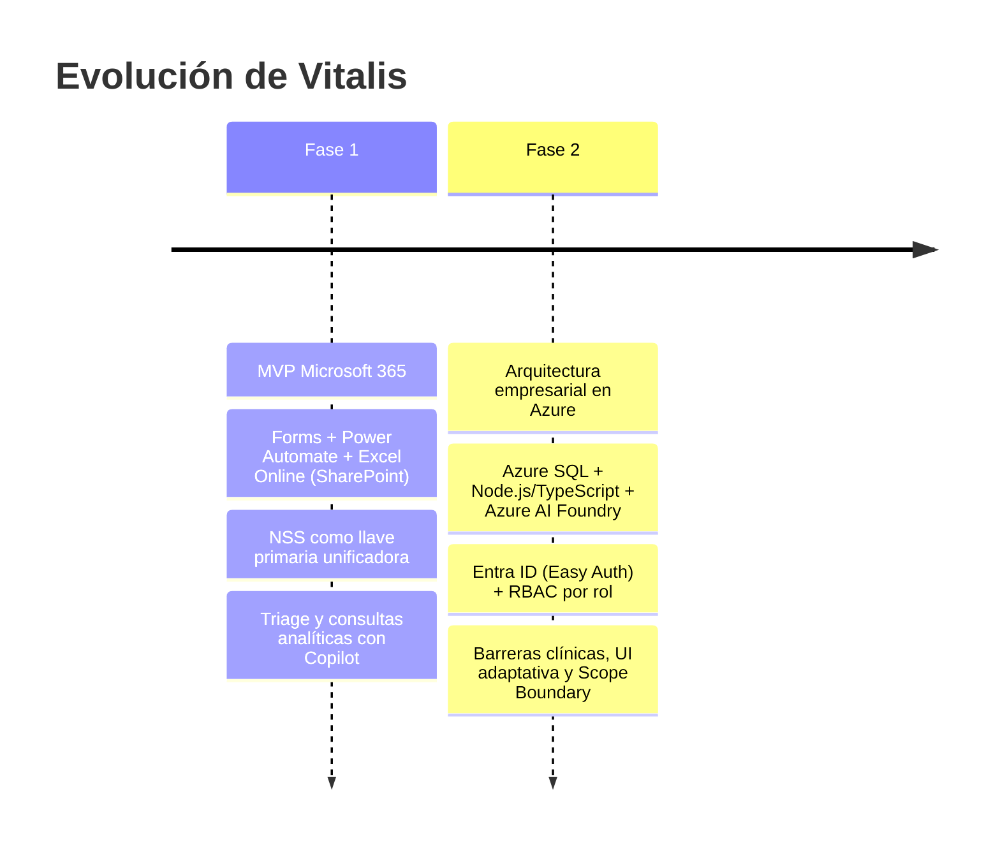
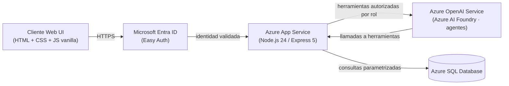

<div align="center">


# Vitalis

**Sistema Integral de Gestión Hospitalaria y Asistente Clínico Inteligente**

Node.js 24 LTS · Express 5 · TypeScript · Azure SQL · Azure AI Foundry · Microsoft Entra ID

</div>

---

## Tabla de contenido

1. [Identidad del proyecto y resumen ejecutivo](#1-identidad-del-proyecto-y-resumen-ejecutivo)
2. [Planteamiento del problema](#2-planteamiento-del-problema)
3. [Evolución del proyecto: de la Fase 1 a la fase actual](#3-evolución-del-proyecto-de-la-fase-1-a-la-fase-actual)
4. [Arquitectura técnica y modelo de datos relacional](#4-arquitectura-técnica-y-modelo-de-datos-relacional)
5. [Matriz de roles y control de acceso (RBAC)](#5-matriz-de-roles-y-control-de-acceso-rbac)
6. [Evidencia gráfica y capturas de pantalla](#6-evidencia-gráfica-y-capturas-de-pantalla)
7. [Guía de instalación, pruebas y despliegue](#7-guía-de-instalación-pruebas-y-despliegue)
8. [Referencias de API, configuración y estructura del repositorio](#8-referencias-de-api-configuración-y-estructura-del-repositorio)

---

## 1. Identidad del proyecto y resumen ejecutivo

| Campo | Detalle |
| --- | --- |
| **Nombre del sistema** | Vitalis — Sistema Integral de Gestión Hospitalaria y Asistente Clínico Inteligente |
| **Autor / desarrollador** | Maximiliano Flores Rodríguez |
| **Estado** | En producción en Azure App Service (Linux, Node.js 24 LTS) |
| **Frontend** | HTML5, CSS3 y JavaScript vanilla (sin frameworks, CDNs ni empaquetadores) |
| **Backend** | Node.js 24 LTS, Express 5, TypeScript compilado a ES Modules (NodeNext) |
| **Datos** | Azure SQL Database |
| **IA** | Ecosistema de agentes en Azure AI Foundry (`@azure/ai-projects` 2.x) |
| **Identidad** | Microsoft Entra ID (Easy Auth) y `DefaultAzureCredential` / Managed Identity |

### Propósito

Transformar la gestión hospitalaria mediante la **erradicación del papel y de los silos de información**,
transitando hacia una arquitectura de **alta disponibilidad en la nube** con **agentes conversacionales
seguros** y **gobernanza estricta de los datos clínicos**.

Vitalis ofrece una interfaz conversacional única. Cada empleado autenticado conversa con un orquestador que
delega en agentes especializados (admisión, históricos, seguros, atención médica y farmacia). El backend decide,
según el rol real del empleado registrado en la base de datos, qué herramientas puede ejecutar el agente. El
modelo nunca tiene acceso directo a la base de datos: solo puede invocar herramientas del backend, que validan
rol, argumentos y reglas clínicas antes de ejecutar consultas parametrizadas.

---

## 2. Planteamiento del problema

| # | Problema | Cómo lo resuelve Vitalis |
| --- | --- | --- |
| 1 | **Tiempos de espera prolongados y saturación en admisión hospitalaria.** | Alta, búsqueda y validación de pacientes en lenguaje natural, con una sola captura del NSS y reutilización de la identidad en todas las áreas. |
| 2 | **Fragmentación y dispersión de expedientes clínicos físicos ("archivo muerto").** | Expediente digital unificado en Azure SQL (`dbo.master`), con el NSS como llave de identidad compartida entre admisión, históricos, seguros, atención y farmacia. |
| 3 | **Errores humanos en la transcripción manual de identificadores críticos (NSS, CURP).** | El agente extrae el identificador y lo envía tal cual a una consulta parametrizada; no se reescribe ni se reformatea, y el alta exige un paciente existente para los antecedentes. |
| 4 | **Falta de auditoría y trazabilidad en la dispensación de recetas y la validación de coberturas.** | Entrega transaccional (ACID) que descuenta inventario y cambia el estatus en una sola operación, con confirmación explícita por botón y control por rol. La cobertura se valida contra `dbo.seguros` con estatus binario. |
| 5 | **Riesgos clínicos por omisión de antecedentes alérgicos y contraindicaciones farmacológicas.** | El agente médico valida alergias registradas antes de generar recetas y alerta sobre contraindicaciones (por ejemplo, alergia a AINEs/Aspirina). |

---

## 3. Evolución del proyecto: de la Fase 1 a la fase actual



### Fase 1 — MVP de digitalización y automatización con Microsoft 365

- **Migración de expedientes físicos** mediante **Microsoft Forms**, flujos de **Power Automate** y almacenamiento
  normalizado en **Excel Online sobre SharePoint**, con las tablas `T_Historico`, `T_Polizas`, `T_Admision` y
  `T_Triage`.
- **Asignación estricta del NSS como llave primaria (PK)** unificadora de la identidad del paciente en todas las
  tablas.
- **Validación automatizada de la vigencia de las pólizas** y bifurcaciones condicionales de altas y renovaciones
  en Ventas.
- **Módulo de Triage** y toma de constantes vitales en ventanilla.
- **Inteligencia operativa inicial** mediante consultas analíticas en lenguaje natural con Copilot.

### Fase 2 / actual — Arquitectura empresarial en la nube con IA y Azure

- **Motor de base de datos transaccional.** Migración a **Azure SQL Database** con restricciones de integridad
  binaria (`Latin1_General_100_BIN2`), transaccionalidad ACID y tablas normalizadas: `dbo.admision`,
  `dbo.historicos`, `dbo.seguros`, `dbo.atencion`, `dbo.farmacia`, `dbo.medicamentos` (catálogo de 1,000 ítems) y
  la vista unificada `dbo.master`.
- **Backend y orquestador de IA.** Servidor **Node.js / TypeScript** sobre **Azure App Service** integrado con
  modelos de **Azure OpenAI / Azure AI Foundry**. El orquestador (`Agente-Orquestador`) es el punto de entrada
  del chat y delega en los agentes de admisión, históricos, seguros, médico y farmacia.
- **Seguridad perimetral y RBAC.** Autenticación institucional con **Microsoft Entra ID (Easy Auth)** y roles:
  `Admin`, `Medico`, `Farmacia`, `Admision`, `Historicos`, `Finanzas` y `Seguros`. El rol se resuelve desde
  `dbo.empleados` en cada solicitud; si la cuenta ya no tiene un perfil activo, se rechaza el acceso.
- **Barreras de seguridad clínica y farmacológica.**
  - Alertas automáticas de contraindicación médica (alergias cruzadas como AINEs/Aspirina).
  - Comprobación obligatoria de la vigencia de la póliza antes de las consultas médicas.
  - Protocolo de desambiguación guiada en farmacia: si una receta coincide con varias presentaciones, se
    devuelven candidatos (`Clave` / `Insumo` / `Descripción`) y se exige confirmar la clave exacta; no se
    permiten sustituciones no prescritas.
- **UI / UX adaptativa.**
  - Acciones rápidas filtradas dinámicamente según el rol autenticado.
  - Plantillas de consulta sin datos personales (por ejemplo, `NSS: [ingrese NSS]`), para evitar fugas de PHI.
  - Botones interactivos de confirmación (`[ Confirmar entrega ]` / `[ Cancelar ]`) mediante el objeto
    `confirmationRequest`.
  - Edición de mensajes enviados (✎): al guardar se trunca el historial visual desde ese mensaje y se reenvía la
    petición corregida a `/api/chat`.
  - Identidad visual: logotipo institucional y fondo hospitalario sutil (patrón ECG en SVG a opacidad 0.06).
- **Operación de farmacia alineada al flujo real.**
  - Bandeja global de recetas pendientes sin NSS para `Farmacia` y `Admin`
    (`id_receta`, `medicamento`, `cantidad` y paciente).
  - Consulta y entrega directa por **número de receta** (`id_receta`): el backend localiza la fila, muestra sus
    datos y, si está `Pendiente`, emite el `confirmationRequest` sin exigir el NSS.
  - Consulta de inventario crítico por stock (`consultar_inventario_stock`).
  - Registro y actualización de antecedentes clínicos por el área de Históricos
    (`registrar_o_actualizar_historico`).
- **Blindaje del agente (*Scope Boundary*).** Instrucciones de prevalencia estricta en el orquestador para
  rechazar solicitudes ajenas a la operación hospitalaria (programación, tareas escolares, cocina, redacción
  creativa, etc.) y para neutralizar intentos de *jailbreak* o *prompt injection*. La regla de alcance es la
  primera sección de las instrucciones del agente. Los protocolos complementarios viven en
  [`Protocolos/`](Protocolos) (`AntiJailbreak`, `CeroAlucinacion`, `FalloSeguro`, `FronterasRol`,
  `SOP_Orquestador_Vitalis`).

---

## 4. Arquitectura técnica y modelo de datos relacional

### 4.1 Flujo de datos



Resumen de la secuencia:

`Cliente Web UI` ➔ `Microsoft Entra ID (Easy Auth)` ➔ `Azure App Service (Node.js/Express)` ➔
`Azure OpenAI Service (Foundry)` ➔ `Azure SQL Database`.

Principios de diseño:

- El modelo **nunca** accede a la base de datos. Solo solicita herramientas; el backend las autoriza por rol,
  valida los argumentos y ejecuta consultas parametrizadas.
- Las acciones sensibles (entrega en farmacia) requieren **confirmación explícita** mediante botones. El backend
  vuelve a validar el rol y el payload al recibir la confirmación.
- Los mensajes de chat solo viven en la memoria del navegador; no se guardan en almacenamiento local.
- Los errores internos devuelven un `500` genérico, sin trazas ni secretos.

### 4.2 Modelo de datos (Azure SQL)

| Entidad | Clave | Descripción y campos principales |
| --- | --- | --- |
| `dbo.admision` | `nss` (PK) | Alta del paciente: `nombre`, `telefono`, `contacto_emergencia`, `parentesco`, `telefono_emergencia`. |
| `dbo.historicos` | `nss` (PK/FK) | Antecedentes: `fecha_nacimiento`, `sexo`, `tipo_sangre`, `alergias`, `enfermedades_cronicas`, `cirugias_previas`, `antecedentes_familiares`, `habitos_toxicologias`, `discapacidades_dispositivos`. |
| `dbo.seguros` | `id_seguro` (PK), `nss` (FK) | Cobertura: `aseguradora`, `estatus` (`Activa`, `Vencida`, `Suspendida`). |
| `dbo.atencion` | `id_atencion` (PK, IDENTITY), `nss` (FK) | Consulta: `fecha_hora`, `motivo_consulta`, `signos_vitales`, `notas_medicas`, `diagnostico`. |
| `dbo.farmacia` | `id_receta` (PK, IDENTITY), `id_atencion` (FK) | Receta: `medicamento`, `dosis_y_tiempo`, `cantidad` (entero positivo de unidades), `estatus_farmacia` (`Pendiente`, `Entregado`). |
| `dbo.medicamentos` | — | Catálogo e inventario de 1,000 ítems: `[Clave]`, `[Insumo]`, `[Descripción]`, `[stock]`. |
| `dbo.empleados` | `id_empleado` (PK) | Personal: `nombre`, `correo`, `rol`, `estatus`. Fuente de verdad del RBAC. |
| `dbo.master` (vista) | — | `SELECT` consolidado con `LEFT JOIN` de las tablas de pacientes; incluye `parentesco` y `cantidad`. |

Notas:

- Las tablas de paciente se relacionan por NSS; la receta se vincula al paciente a través de `dbo.atencion`.
- La migración [`scripts/migrations/20261105_agregar_cantidad_receta.sql`](scripts/migrations/20261105_agregar_cantidad_receta.sql)
  agrega `cantidad` a `dbo.farmacia` y su restricción.
- Los agentes de Triage y Asignación están **deprecados**; la evaluación de síntomas y signos vitales la absorbe
  `Agente-Medico`.

### 4.3 Ecosistema de agentes (Azure AI Foundry)

| Agente | Responsabilidad |
| --- | --- |
| `Agente-Orquestador` | Punto de entrada del chat; delega según el rol y la necesidad. |
| `Agente-Admision` | Identificación y alta de pacientes. |
| `Agente-Historico` | Antecedentes clínicos y alergias. |
| `Agente-Seguros` | Validación binaria de cobertura (`Activa`). |
| `Agente-Medico` | Evaluación de síntomas y signos vitales, notas SOAP, diagnósticos y recetas con validación previa de alergias. |
| `Agente-Farmacia` | Gestión logística: consulta recetas y actualiza a `Entregado`. |

### 4.4 Herramientas del backend

| Herramienta | Función |
| --- | --- |
| `buscar_paciente_admision` | Localiza un paciente por NSS. |
| `registrar_admision` | Da de alta o actualiza datos de admisión. |
| `consultar_historico` | Consulta antecedentes clínicos. |
| `obtener_expediente_master` | Expediente consolidado (`dbo.master`). |
| `validar_poliza` | Valida cobertura por estatus. |
| `evaluar_consulta_medica` | Registra atención, nota, diagnóstico y recetas, con validación de alergias. |
| `gestionar_farmacia` | Acciones `pendientes` (bandeja general o por paciente), `consultar` (por `id_receta`) y `entregar` (con confirmación). |
| `consultar_catalogo_medicamentos` | Búsqueda en el catálogo por insumo, descripción o clave. |
| `consultar_inventario_stock` | Medicamentos con `menor` o `mayor` stock (`limite` máximo de 50). |
| `registrar_o_actualizar_historico` | Alta o actualización de antecedentes de un NSS existente. |

---

## 5. Matriz de roles y control de acceso (RBAC)

El rol proviene de `dbo.empleados` y se verifica en cada llamada a una herramienta (`src/rbac.ts`). Una
herramienta desconocida o un rol no autorizado se rechaza; el agente informa con tono profesional que el rol
actual no permite esa acción y no revela detalles de implementación.

### 5.1 Permisos por herramienta

| Herramienta | Admin | Medico | Farmacia | Admision | Historicos | Seguros | Finanzas |
| --- | :---: | :---: | :---: | :---: | :---: | :---: | :---: |
| `buscar_paciente_admision` | ✅ | — | — | ✅ | — | — | — |
| `registrar_admision` | ✅ | — | — | ✅ | — | — | — |
| `consultar_historico` | ✅ | ✅ | — | ✅ | — | — | — |
| `obtener_expediente_master` | ✅ | ✅ | — | ✅ | — | — | — |
| `validar_poliza` | ✅ | — | — | — | — | ✅ | ✅ |
| `evaluar_consulta_medica` | ✅ | ✅ | — | — | — | — | — |
| `gestionar_farmacia` | ✅ | — | ✅ | — | — | — | — |
| `consultar_catalogo_medicamentos` | ✅ | ✅ | ✅ | — | — | — | — |
| `consultar_inventario_stock` | ✅ | ✅ | ✅ | — | — | — | — |
| `registrar_o_actualizar_historico` | ✅ | — | — | — | ✅ | — | — |

### 5.2 Alcance por rol

| Rol | Alcance funcional | Acciones rápidas en la UI |
| --- | --- | --- |
| **Admin** | Acceso a todas las herramientas: expediente, póliza, atención, farmacia, inventario e históricos. | Todas (Expediente, Póliza, Atención/Evolución, Farmacia, Históricos). |
| **Medico** | Consulta de expediente e históricos, evaluación y nota de atención, catálogo e inventario. | Consultar Expediente; Nota de Evolución / Atención médica. |
| **Farmacia** | Bandeja y entrega de recetas (con confirmación), catálogo e inventario. No exige NSS si hay número de receta. | Farmacia y Recetas (revisar pendientes); Consultar Inventario. |
| **Admision** | Registro y consulta de pacientes, históricos y expediente consolidado. | Registrar Paciente; Consultar Paciente. |
| **Historicos** | Registro y actualización de antecedentes clínicos de un NSS existente. | Registrar / Consultar Antecedentes Clínicos. |
| **Seguros** | Validación de póliza y cobertura. | Validar Póliza / Cobertura. |
| **Finanzas** | Validación de póliza y cobertura (herramienta `validar_poliza`). | — (la interfaz no define acciones rápidas específicas para este rol). |

> Nota: el rol `Finanzas` está habilitado en el control de acceso del backend. Las acciones rápidas de la UI
> están definidas para `Admin`, `Medico`, `Farmacia`, `Admision`, `Seguros` e `Historicos`. El rol debe existir
> también en la restricción de `dbo.empleados` para poder asignarse a un empleado.

---

## 6. Evidencia gráfica y capturas de pantalla

### 6.1 Recursos gráficos incluidos en el repositorio

| Recurso | Ruta | Vista previa |
| --- | --- | --- |
| Logotipo institucional | [`public/img/logo.png`](public/img/logo.png) |  |
| Patrón hospitalario (ECG) del fondo | [`public/img/ecg-pattern.svg`](public/img/ecg-pattern.svg) |  |

### 6.2 Capturas del proyecto

Las capturas se guardan en `docs/img/`. Las siguientes referencias indican el nombre esperado de cada archivo;
los archivos marcados como **pendiente** aún no están en el repositorio y deben agregarse con capturas reales
(sin datos de pacientes reales) para que el enlace se muestre.

| # | Evidencia | Archivo esperado | Estado |
| --- | --- | --- | --- |
| 1 | Flujos de Power Automate y migración de la Fase 1 | `docs/img/fase1-power-automate.png` | Pendiente |
| 2 | Interfaz principal de bienvenida con RBAC (acciones rápidas por rol) | `docs/img/bienvenida-rbac.png` | Pendiente |
| 3 | Nuevo logotipo institucional | [`public/img/logo.png`](public/img/logo.png) | Incluido |
| 4 | Flujo de interacción en Farmacia con botones de confirmación | `docs/img/farmacia-confirmacion.png` | Pendiente |
| 5 | Alertas clínicas de contraindicación por alergias | `docs/img/alerta-alergias.png` | Pendiente |
| 6 | Blindaje de seguridad: rechazo de prompts fuera de alcance | `docs/img/rechazo-fuera-de-alcance.png` | Pendiente |

Para incrustar cada captura una vez agregada, usa:

```markdown

```

### 6.3 Comportamiento esperado (referencia visual en texto)

**Entrega en farmacia con botones**

```text
Empleado : entrega la receta 3
Vitalis  : Receta 3 · PARACETAMOL · cantidad 2 · paciente <NSS> · estatus Pendiente.
           ¿Confirmas que la entrega física de la receta 3 ya fue realizada?
           [ Confirmar entrega ]  [ Cancelar ]
```

**Rechazo fuera de alcance**

```text
Usuario : escríbeme un script en Python
Vitalis : Soy el asistente de gestión hospitalaria de Vitalis. Solo puedo asistirte en tareas clínicas,
          administrativas, consultas de inventario, recetas y expedientes del hospital.
```

---

## 7. Guía de instalación, pruebas y despliegue

### 7.1 Requisitos previos

- **Node.js 24 LTS** y `npm`. El campo `engines` de `package.json` exige `24.x`.
- **Azure CLI** (`az`) con sesión iniciada (`az login`) y acceso al grupo de recursos y al proyecto de Foundry.
- Un registro de aplicación de Microsoft Entra para el inicio de sesión local.
- Acceso a una base de datos Azure SQL con el esquema de la sección 4.2.
- Windows 11 con PowerShell (entorno de referencia).

### 7.2 Desarrollo local

1. Copia `.env.example` a `.env` y completa los valores. **No agregues credenciales al repositorio.**
2. Genera `SESSION_SECRET`:

   ```powershell
   node -e "console.log(require('node:crypto').randomBytes(32).toString('base64url'))"
   ```

3. Registra la aplicación de Entra con la URI de redirección `http://localhost:8000/auth/callback` (plataforma
   web) y define `MSAL_CLIENT_ID` y `MSAL_CLIENT_SECRET` en `.env`.
4. Inicia sesión con `az login` para que `DefaultAzureCredential` acceda a Foundry.
5. Instala, compila, prueba y ejecuta:

   ```powershell
   npm ci
   npm run build
   npm test
   npm start
   ```

6. Abre `http://localhost:8000` y valida la salud del servidor:

   ```powershell
   Invoke-RestMethod -Uri "http://localhost:8000/health"
   Invoke-RestMethod -Uri "http://localhost:8000/healthz"
   ```

### 7.3 Pruebas unitarias

```powershell
npm test
```

`npm test` compila el proyecto y ejecuta `node --test "dist/tests/*.test.js"`. La suite actual contiene **38
pruebas automatizadas** que cubren, entre otros:

- Matriz completa de roles y herramientas, y rechazo de alias, mayúsculas/minúsculas y herramientas desconocidas.
- Validación de configuración SQL, consulta de inventario por stock y registro de históricos.
- Flujo de farmacia: confirmación por botones, bandeja de pendientes sin NSS, consulta y entrega por `id_receta`,
  y rechazo de recetas inexistentes o ya entregadas.
- Frontera de alcance: la regla de rechazo encabeza las instrucciones del agente (por ejemplo, ante peticiones de
  código Python).
- Cifrado de la cookie de sesión y detección de manipulación.
- Renderizado de Markdown sin HTML ni protocolos de enlace inseguros.

> La prueba de alcance valida el texto de las instrucciones, no el comportamiento real del modelo. Se recomienda
> probar el rechazo en el entorno desplegado con una petición como "escríbeme un script en Python".

### 7.4 Variables de entorno

| Variable | Uso |
| --- | --- |
| `VITALIS_ENTRA_TENANT_ID` | Tenant permitido de Entra ID. |
| `PROJECT_ENDPOINT` | Endpoint del proyecto de Azure AI Foundry. |
| `ORCHESTRATOR_AGENT_NAME`, `ADMISSION_AGENT_NAME`, `HISTORY_AGENT_NAME`, `INSURANCE_AGENT_NAME`, `CONSULTATION_AGENT_NAME`, `PHARMACY_AGENT_NAME` | Nombres de los agentes de Foundry. |
| `AZURE_SQL_CONNECTION_STRING` | Conexión a Azure SQL. |
| `SESSION_SECRET` | Secreto aleatorio para cifrar la cookie de sesión. |
| `MSAL_CLIENT_ID`, `MSAL_CLIENT_SECRET`, `AUTH_REDIRECT_URI` | Inicio de sesión local (la URI por defecto es `http://localhost:8000/auth/callback`). |
| `APPLICATIONINSIGHTS_CONNECTION_STRING` | Telemetría opcional. |
| `ALLOWED_ADMIN_DOMAIN` | Opcional (por defecto `labmx.ai`). Las cuentas de Entra con correo de este dominio que no estén en `dbo.empleados` operan como `Admin`; si ya existen en la tabla se respeta su rol, y si están `Inactivo` se les deniega el acceso. |
| `PORT` | Puerto de escucha (por defecto `8000`). |

Usa los nombres de `.env.example` y nunca copies secretos de `.env` al repositorio.

### 7.5 Despliegue precompilado a Azure App Service

El despliegue empaqueta el código ya compilado y las dependencias de producción, de modo que App Service no
necesita compilar.

```powershell
# 1. Compilar y dejar solo dependencias de producción
npm run build
npm ci --omit=dev

# 2. Generar el ZIP en %TEMP% con separadores Linux (/) en las rutas internas
#    Contenido: package.json, package-lock.json, dist/src, public/ y node_modules/
$env:ZIPOUT = Join-Path $env:TEMP "vitalis-deploy.zip"
```

Rutas con `/` dentro del ZIP (ejemplo con Python y `zipfile`):

```python
import os, zipfile

out = os.environ["ZIPOUT"]
with zipfile.ZipFile(out, "w", zipfile.ZIP_DEFLATED) as z:
    for f in ("package.json", "package-lock.json"):
        z.write(f, f)
    for root in ("dist/src", "public", "node_modules"):
        for d, _, files in os.walk(root):
            for n in files:
                p = os.path.join(d, n)
                z.write(p, p.replace(os.sep, "/"))
```

```powershell
# 3. Desplegar
az webapp deploy --resource-group VitalisRG --name Vitalis-App --src-path $env:ZIPOUT --type zip --clean true

# 4. Restaurar dependencias de desarrollo, verificar y limpiar
npm install
Invoke-RestMethod -Uri "https://vitalis-app.azurewebsites.net/healthz"   # { "status": "ok" } con HTTP 200
Remove-Item $env:ZIPOUT
```

Observaciones operativas:

- `az webapp deploy` puede devolver código de salida distinto de cero aunque el despliegue termine bien. Confirma
  el estado `RuntimeSuccessful` en su salida o con `az webapp log deployment list`.
- El arranque del sitio tras el despliegue puede tardar varios minutos. Si el sondeo de `az` se detiene, usa
  `--timeout` o consulta el registro de despliegues.
- El comando de inicio es `npm start` (`dist/src/bootstrap.js`).

### 7.6 Configuración de Azure App Service y Easy Auth

- Linux con el stack `NODE|24-lts`.
- Habilita **Identidad Administrada** y concede el rol mínimo para invocar los agentes del proyecto de Foundry
  (`Azure AI Developer` / `Cognitive Services OpenAI Contributor`).
- Habilita **App Service Authentication** con Microsoft Entra y **exige autenticación**. La aplicación confía en
  `X-MS-CLIENT-PRINCIPAL` únicamente porque Easy Auth lo valida antes de llegar a Node.
- **No excluyas `/` ni `/api/*` de la autenticación**: hacerlo abriría la puerta a la suplantación de cabeceras
  (*header spoofing*). Solo se excluyen rutas sin información sensible: `/healthz`, `/img/*` y `/styles.css`.
- Guarda `SESSION_SECRET` como secreto de App Service o Key Vault. Conserva `PROJECT_ENDPOINT`, los
  `*_AGENT_NAME` y `AZURE_SQL_CONNECTION_STRING` del recurso.

### 7.7 Actualización de prompts de los agentes

```powershell
npm run update-prompts
```

Publica una nueva versión de cada agente de tipo prompt con los protocolos locales de `Protocolos/`. Requiere
credenciales de `DefaultAzureCredential` y los nombres de agentes configurados.

### 7.8 Contenedor (opcional)

```powershell
docker build -t vitalis .
docker run --env-file .env -p 8000:8000 vitalis
```

---

## 8. Referencias de API, configuración y estructura del repositorio

### 8.1 Endpoints

| Método y ruta | Descripción |
| --- | --- |
| `GET /health`, `GET /healthz` | Diagnóstico: `{ "status": "ok" }` con HTTP 200. |
| `GET /auth/login`, `GET /auth/callback`, `POST /auth/logout` | Autenticación. |
| `GET /api/me` | Identidad y rol del empleado autenticado. |
| `POST /api/new-chat` | Inicia una conversación nueva. |
| `POST /api/chat` | Procesa un mensaje o una confirmación (`{ "confirmation": payload }`). Devuelve `response` y, cuando se requiere confirmación, `confirmationRequest`. |

Contrato de `confirmationRequest`:

```json
{
  "title": "¿Confirmas que la entrega física de la receta 3 ya fue realizada?",
  "confirmLabel": "Confirmar entrega",
  "cancelLabel": "Cancelar",
  "actionPayload": { "accion": "entregar_receta", "nss": "<NSS>", "id_receta": 3, "clave_medicamento": null }
}
```

Reglas de validación: el mensaje debe ser texto no vacío de hasta 8,000 caracteres; los payloads inválidos
devuelven `400 Bad Request`, y los errores internos un `500 Internal Server Error` genérico.

### 8.2 Estructura del repositorio

| Ruta | Contenido |
| --- | --- |
| `src/` | Backend TypeScript: `bootstrap.ts`, `server.ts`, `ai.ts`, `db.ts`, `rbac.ts`, `config.ts`. |
| `public/` | Interfaz vanilla (`index.html`, `app.js`, `styles.css`) y `img/` (logotipo y patrón ECG). |
| `tests/` | Pruebas unitarias (`node:test`). |
| `scripts/` | Utilidades y migraciones SQL (`scripts/migrations/`). |
| `Protocolos/` | Protocolos de los agentes (anti-jailbreak, cero alucinación, fallo seguro, fronteras de rol, SOP del orquestador). |
| `dist/` | Salida compilada (no se versiona). |

### 8.3 Reglas de seguridad y estilo

- Ninguna contraseña, cadena de conexión ni llave en el código fuente o en los commits.
- Consultas SQL siempre parametrizadas; sin `innerHTML` con entradas no sanitizadas.
- Stack autorizado: `express` 5, `mssql`, `@azure/ai-projects` 2.x y `@azure/identity`. Están prohibidos Python,
  Streamlit, `@azure/ai-agents` 1.x y los frameworks de frontend.
- Comentarios y documentación en español neutro; variables y funciones en inglés.

---

<div align="center">

**Vitalis** · Desarrollado por **Maximiliano Flores Rodríguez**

</div>
